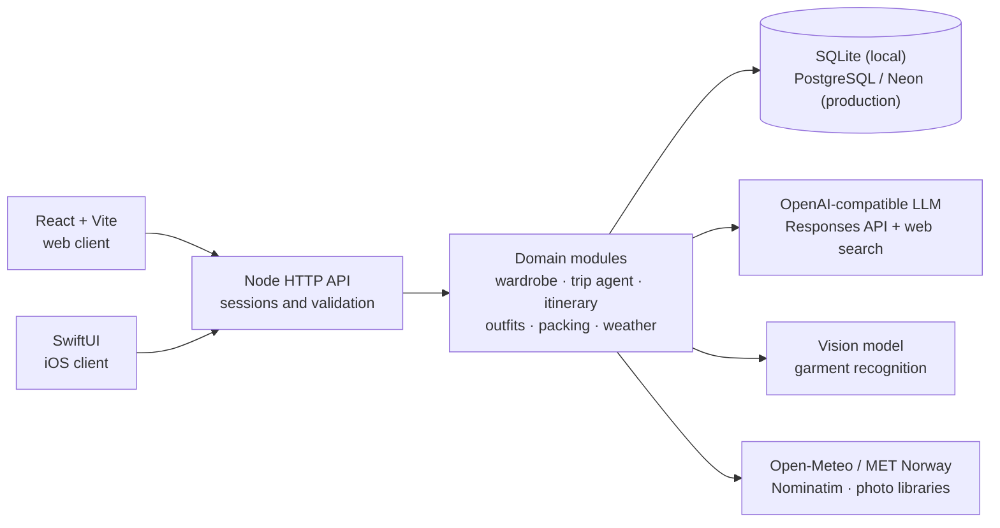
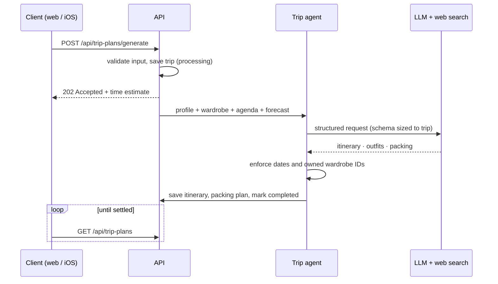

<p align="right">
  <b>English</b> ·
  <a href="README.zh-CN.md">简体中文</a>
</p>

# WearRoute

> An AI travel-wardrobe assistant that turns your own clothes, your itinerary, and the destination forecast into day-by-day outfits and a packing list.

WearRoute answers two questions before a trip: *what should I wear each day,* and *what do I need to pack?* Users photograph their clothes once to build a digital wardrobe. When they plan a trip, an AI agent combines that wardrobe with their style profile, the trip scenario, their agenda, and the destination forecast. It returns a grounded itinerary, an outfit for each day built from items they own, weather-specific gear, and one packing list that reuses pieces across days.

The project was built by a four-person team during a three-day hackathon (23–25 August 2026). It ships as a React web app and a native SwiftUI iOS app on a shared Node API, deployed on Render with a Neon PostgreSQL database. This README describes my individual engineering contributions and credits the rest of the team at the end.

## At a Glance

- **Photo to wardrobe:** a vision model turns a garment photo into a structured record (category, style, colours, fit, material, seasons and construction details). Photos that show no clothing are rejected.
- **AI trip agent:** one structured-output request, grounded with web search, produces the itinerary, daily outfits that reference real wardrobe items, weather gear and a consolidated packing list.
- **Itinerary view:** a route overview, a timeline for each day, and a scenery photo found automatically for every stop.
- **Packing slider:** moves the list between "pack light" and "more variety" using the agent's priority for each item.
- **Native iOS client:** about 9,400 lines of SwiftUI with no third-party dependencies. It mirrors every web page against the same API.
- **Bilingual:** the web and iOS apps both run in English and 简体中文.

## My Role and Contributions

**Weize Zheng ([`@W1chik2nd`](https://github.com/W1chik2nd)): AI trip agent, digital wardrobe, itinerary experience, and the native iOS client**

- **AI trip-planning agent** ([#34](https://github.com/W1chik2nd/WearRoute/pull/34), [#40](https://github.com/W1chik2nd/WearRoute/pull/40)). I wrote the agent prompt and a strict JSON Schema that is sized to the trip length. I wrote the Responses API request builder, which sets reasoning, verbosity and output-token limits per model, adds web-search grounding, and keeps OpenAI-compatible gateways working. I wrote the server-side checks that enforce exact dates and real wardrobe IDs. Generation runs asynchronously, keeps its status in the database, lets the user retry a failed trip, and supports several trips per user through a dashboard trip switcher.
- **Digital wardrobe** ([#10](https://github.com/W1chik2nd/WearRoute/pull/10), [#18](https://github.com/W1chik2nd/WearRoute/pull/18), [#20](https://github.com/W1chik2nd/WearRoute/pull/20)). This covers photo recognition through an OpenAI-compatible vision model, rejection of non-clothing photos, accessory support, persistence, editing and deletion, and the category filter. It also includes QR-code upload from a phone to the desktop and "shop similar" search against the JD Union and Taobao affiliate APIs, using the request signing those platforms require.
- **Itinerary experience** ([#12](https://github.com/W1chik2nd/WearRoute/pull/12), [#14](https://github.com/W1chik2nd/WearRoute/pull/14)). I built the trip → day → stop data model, the route overview and daily plan, and a scenery-photo service that works with Unsplash, Pexels or Openverse. Its search keywords are ordered by a hit-rate probe I wrote. I also wrote the headless render-check and layout-probe scripts the team used to catch UI regressions.
- **Profile** ([#17](https://github.com/W1chik2nd/WearRoute/pull/17), [#28](https://github.com/W1chik2nd/WearRoute/pull/28)). I built the personal profile page and connected profile editing to the data captured at registration, with API tests.
- **Native iOS client** ([#60](https://github.com/W1chik2nd/WearRoute/pull/60), [#62](https://github.com/W1chik2nd/WearRoute/pull/62)). I wrote the whole SwiftUI app: 57 Swift files for iOS 17+. It covers every web page against the same API. It stores the session in the Keychain and compresses photos to fit the upload limit. It draws its own OpenStreetMap tile map with a Mercator projection, and it renders the web app's SVG brand artwork with a small path parser. It has bilingual strings, XCTest coverage for home-screen presentation, and a configuration for the production backend.
- **Foundations** ([#2](https://github.com/W1chik2nd/WearRoute/pull/2), [#45](https://github.com/W1chik2nd/WearRoute/pull/45), [#46](https://github.com/W1chik2nd/WearRoute/pull/46), [#61](https://github.com/W1chik2nd/WearRoute/pull/61)). I built the landing page, wrote the Bauhaus design specification in [AGENTS.md](AGENTS.md), designed the hanger-pin logo, and wrote the bilingual project documentation.

See [pull requests I authored](https://github.com/W1chik2nd/WearRoute/pulls?q=is%3Apr+author%3AW1chik2nd) for the implementation history.

### After the hackathon

After the event I audited the whole codebase for defects in existing features (not missing features) and fixed them across the API, web and iOS clients:

- **Correctness.** Garment categories were classified by three separate keyword lists (server, web, iOS) that disagreed: T-shirts, knitwear and hoodies were treated as accessories, and a hooded top matched "帽" (hat). The server now decides one canonical `kind` and both clients filter by it. Request bodies were decoded chunk by chunk, which corrupted Chinese characters split across network packets. The local calendar day now decides "today's outfit" instead of UTC.
- **Plan consistency.** The packing list is now derived from the daily outfits. Before, an owned item worn but not packed was shown as a wardrobe gap, and the packing days could disagree with the day cards. The lean/variety slider can no longer hide a piece an outfit uses, and the item count is computed from what is shown. Checklist ticks are stored per trip on the server instead of in browser or device storage.
- **Reliability.** Generation jobs hold a renewable lease on the trip row. A job orphaned by a restart or deploy is taken over by another instance instead of being failed, and completion is one transaction guarded by the worker's token. Two crash paths were removed: an unhandled `pg` pool error and an unhandled rejection while recording a failure. Outbound AI, vision, photo and shopping calls now time out.
- **Security and cost.** Sessions expire and slide forward. Password hashing no longer blocks the event loop. Paid and unauthenticated routes are rate-limited, and logins are throttled per account. Session tokens no longer appear in photo URLs. The assistant must ask the user before deleting anything, and trips it creates are geocoded and generated like any other.
- **Data quality.** Recognition stores an English title alongside the Chinese one. Dates beyond the ~16-day forecast window get typical weather from the last three years, clearly labelled. The backup weather provider groups hours by local date, and the trip weather page lists forecast changes since the outfits were planned. Stops without a scenery photo are no longer looked up again on every view.
- **Verification.** The server suite now runs with outbound network blocked, a new PostgreSQL integration suite covers the production code paths, and GitHub Actions runs everything on each push.

## Engineering Highlights

### One agent call, one consistent plan

The itinerary, outfits and packing list come from a single structured response, so they refer to each other: each outfit points at wardrobe IDs, and each packing row records the days it is used. The JSON Schema is built per request, so a day reference can never exceed the trip length. The server treats the model's output as untrusted. It checks every date against the requested range, removes wardrobe IDs the user does not own, and fills in only blank text it can derive honestly. Anything else is rejected rather than shown. The outfits are the source of truth for owned clothing: the packing rows' days are recomputed from them, and any worn piece the model forgot to pack is added rather than reported as missing.

### Long-running generation that survives restarts

Planning a trip can take several minutes. The API replies `202 Accepted` with an estimated time range, then runs the agent in the background and stores the status (`processing → completed | failed`) on the trip record, so the web and iOS clients resume correctly after navigation or relaunch. The running worker holds a lease on that row and renews it every minute. If the process dies or is replaced during a deploy, the lease lapses and the next sweep, on any instance, takes the job over with an atomic compare-and-set, up to one automatic retry. Completion writes the itinerary, the packing plan and the status in one transaction, and only if the worker's token still owns the job. A late result from a worker that lost its lease, or for a trip the user deleted, is therefore discarded rather than duplicated.

### From a photo to a usable wardrobe record

The vision prompt asks for details it can actually see, such as pockets, closures, collar and hem, rather than generic adjectives, because those details feed outfit planning. The server maps category aliases onto a fixed set. If the model says a photo is not clothing, or returns mostly unknown fields, the API answers `422`, so no junk enters the wardrobe. Wardrobe list queries never load image bytes. Locally, photos live on disk. In PostgreSQL, the list query selects only whether a photo exists, and images are served from their own endpoint.

### Phone-to-desktop upload without a second login

To add clothes from a laptop, the signed-in desktop creates a random upload token that expires after 10 minutes and shows it as a QR code. The phone posts photos with that token, and only the session's creator can collect them. The session renews while the user keeps shooting, so photographing a whole wardrobe does not hit the expiry.

### Scenery photos that are rarely missing

Each itinerary stop gets a photo from an ordered list of search keywords: the Chinese name with the city, the name alone, the English name, and finally "city + kind of place". I ordered them by a measured hit-rate probe: named restaurants matched 1 time in 5, generic phrases 5 times in 5. Each stop is limited to four lookups to stay within Openverse's anonymous rate limit, and results are cached on the stop. Photos load per card, so the page renders immediately.

### A native client with no business logic

The project's main architecture rule is thin clients and a thick server. The iOS app follows it: recommendation, weather, packing and outfit logic all stay in the API, and the Swift code only calls endpoints, decodes the same response contracts, and renders them. The platform-specific work stays on the device. Photos are resized step by step until the base64 payload fits the server's 8 MB limit. The session token lives in the Keychain. The brand artwork comes from the same SVG files as the web app, so the two cannot drift apart.

## System Architecture





## Product Capabilities

- Accounts with a style questionnaire and a personal-colour helper
- Digital wardrobe: add by photo (or by phone over QR), edit, filter and delete, plus "shop similar" links
- Trip setup: place search, map, date range, scenario and a free-text agenda
- AI-generated itinerary with daily stops, weather risks and scenery photos
- Daily outfit view and a "today" outfit on the dashboard
- Destination forecast for each trip day
- Packing checklist with a variety-versus-lightness slider and travel essentials
- Chat assistant that can navigate and update profile, wardrobe and trips
- English and Chinese throughout, on web and iOS

## Quality and Verification

| Area | Evidence |
|---|---|
| Server tests | `node:test` suites, run with outbound network blocked so no result depends on a live API. Route-level tests use a throwaway SQLite database and cover trip-agent output checks, job leases and takeover, rate limits, sessions, vision parsing and weather fallbacks |
| PostgreSQL tests | `postgres-app.test.ts` runs the production code paths (sessions, generation, packing, cascades, leases) against a real PostgreSQL when `TEST_DATABASE_URL` is set |
| Client tests | Dashboard trip selection, wardrobe filtering, local dates, localisation fallbacks and layouts |
| UI probes | `scripts/render-check.mjs` server-renders the real itinerary components and checks the label geometry for collisions. `scripts/layout-probe.mjs` measures actual card heights in headless Chrome |
| iOS | XCTest suite (`SmartPackTests`). The project builds with zero warnings, as the repository's conventions require |
| Continuous integration | GitHub Actions runs the test suites against a PostgreSQL service, the render and layout probes, the production web build and the iOS build |
| Deployment | One Render web service serves the client and `/api/*`, with a `/api/health` health check and Neon PostgreSQL in its own schema |

## Technology

| Layer | Technology |
|---|---|
| Web client | React 18, TypeScript, Vite, hand-written CSS design tokens |
| iOS client | SwiftUI (iOS 17+), Keychain, no third-party packages |
| API | Node 22 with native TypeScript type stripping, plain `node:http` |
| Persistence | `node:sqlite` locally; PostgreSQL on Neon through `pg` in production |
| AI | OpenAI-compatible Responses API with structured outputs and web search; OpenAI-compatible vision model (DashScope `qwen-vl-plus` by default) |
| Data services | Open-Meteo with MET Norway fallback, Nominatim, Unsplash / Pexels / Openverse, JD Union / Taobao affiliate APIs |
| Testing | `node:test`, custom render and layout probes, XCTest |
| Hosting | Render + Neon |

## Run Locally

Requirements: Node.js 22.6+ and npm. Xcode is needed only for the iOS client.

```bash
git clone https://github.com/W1chik2nd/WearRoute.git
cd WearRoute
npm install
npm run dev
```

`npm run dev` starts the API on port 4177 and the web client on https://localhost:5177. The client uses a self-signed certificate because phone camera access needs a secure context, so accept the browser warning on first visit. A local SQLite database is created at `server/data/wearroute.db`.

AI features are optional. To enable them, copy `server/.env.example` to `server/.env` and set `AI_API_KEY` (trip agent, chat assistant) and `VISION_API_KEY` (garment recognition). Without keys, those endpoints return a clear `503` and everything else keeps working. Never commit `server/.env`.

### iOS

```bash
DEVELOPER_DIR=/Applications/Xcode-beta.app/Contents/Developer xcodebuild \
  -project ios/SmartPack.xcodeproj -scheme SmartPack \
  -destination 'platform=iOS Simulator,name=iPhone 17 Pro' build
```

The backend URL comes from `SmartPackAPIBaseURL` in `ios/Config/Info.plist`. See [ios/README.md](ios/README.md) and [docs/ios-production-backend.md](docs/ios-production-backend.md).

## Verify the Project

```bash
npm test        # server tests, client tests, render check, layout probe
npm run build   # production web build
```

To include the PostgreSQL suite, point it at a disposable database (each run creates and drops its own schema):

```bash
TEST_DATABASE_URL=postgresql://localhost:5432/wearroute_test npm test
```

## Repository Guide

```text
WearRoute/
├── client/     # React + Vite web client (pages, components, i18n, theme)
├── server/     # Node API, trip agent, stores (SQLite + PostgreSQL), tests
├── shared/     # TypeScript contracts shared by client and server
├── ios/        # Native SwiftUI client and XCTest target
├── scripts/    # Dev runner, render/layout probes, photo hit-rate probe
├── .github/    # CI workflow
├── docs/       # Personas, user stories, iOS production notes
└── AGENTS.md   # Engineering and design conventions
```

## Project Context and Attribution

WearRoute was built as a team hackathon project in August 2026, and the team's full history is in this repository. Main areas, based on the pull requests each person authored:

| Contributor | GitHub | Main areas |
|---|---|---|
| Weize Zheng | [`@W1chik2nd`](https://github.com/W1chik2nd) | AI trip agent, digital wardrobe, itinerary and photos, profile page, native iOS client |
| Weiming Chen | [`@zzX100zz`](https://github.com/zzX100zz) | Authentication, Bauhaus design system, dashboard, chat assistant, bilingual UI and translation fallback, outfit rendering, weather resilience, Render/Neon deployment |
| Peijun Gu | [`@hfnz4996`](https://github.com/hfnz4996) | Packing list, trip setup (map, place search, date range), outfit overview, trip weather, shared type contracts |
| Ruoxi Zheng | [`@Snnnnn56`](https://github.com/Snnnnn56) | Style questionnaire and personal-colour helper |

Product personas and user stories are in [docs/personas-and-user-stories.md](docs/personas-and-user-stories.md).
